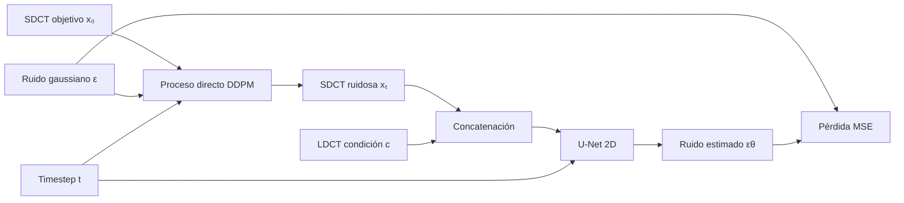
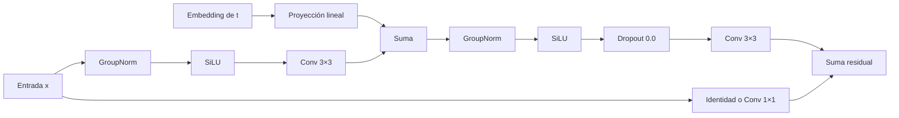

# Arquitectura base DDPM para LDCT

> Modelo condicional de difusión para reconstruir una imagen de dosis estándar
> (**SDCT**) a partir de una adquisición de baja dosis (**LDCT**).

## Resumen

La implementación base activa de DDPM-LDCT trabaja directamente en el
**espacio de píxeles**. El modelo corrompe con ruido gaussiano la imagen SDCT y
entrena una U-Net 2D para predecir el ruido añadido, usando la imagen LDCT como
condición.

| Propiedad | Valor |
|---|---|
| Backbone | `diffusers.UNet2DModel` |
| Espacio de trabajo | Píxeles, 2D |
| Resolución | 256 × 256 |
| Condicionamiento | Concatenación por canales |
| Entrada efectiva | 2 canales: SDCT ruidosa + LDCT |
| Salida | 1 canal: ruido estimado |
| Pasos de difusión para entrenamiento | 1000 |
| Pasos configurados para inferencia | 50 |
| Objetivo | Predicción de ruido, `epsilon` |
| Pérdida | MSE de denoising |
| Parámetros entrenables | 113 669 761 |

La configuración fuente se encuentra en
[`configs/LDCT/pixel/concat/pixel_ddpm_concat_legacy_ldct.json`](../../configs/LDCT/pixel/concat/pixel_ddpm_concat_legacy_ldct.json).

---

## Flujo general



Para una imagen objetivo SDCT \(x_0\), se muestrean un timestep y ruido
gaussiano:

$$
t\sim\mathcal U\{0,\ldots,999\},
\qquad
\epsilon\sim\mathcal N(0,I).
$$

El proceso directo produce:

$$
x_t=\sqrt{\bar\alpha_t}\,x_0
    +\sqrt{1-\bar\alpha_t}\,\epsilon.
$$

La entrada efectiva de la red es la concatenación de la SDCT ruidosa y la
imagen LDCT condicionante:

$$
u_t=\operatorname{concat}(x_t,c)\in\mathbb R^{2\times256\times256}.
$$

La U-Net estima el ruido que fue añadido:

$$
\hat\epsilon=\epsilon_\theta(u_t,t).
$$

> El ruido se aplica únicamente a la imagen objetivo SDCT. La imagen LDCT se
> mantiene sin ruido y actúa como condición anatómica durante el entrenamiento.

---

## Arquitectura de la U-Net

La red es una U-Net simétrica con conexiones *skip*, bloques residuales,
embedding temporal y autoatención en las resoluciones profundas.

```text
Entrada [x_t, LDCT]: 2 × 256 × 256
           │
           ▼
     Conv 3×3: 2 → 128
           │
           ▼
  ┌──────────────────────── Encoder ────────────────────────┐
  │ 256²: 2×ResBlock, 128 ch                               │
  │ 128²: 2×ResBlock, 128 ch                               │
  │  64²: 2×ResBlock, 256 ch                               │
  │  32²: 2×ResBlock, 256 ch                               │
  │  16²: 2×ResBlock + self-attention, 512 ch              │
  │   8²: 2×ResBlock, 512 ch                               │
  └───────────────────────────┬─────────────────────────────┘
                              ▼
             Bottleneck: ResBlock → Attention → ResBlock
                              │
                              ▼
  ┌──────────────────────── Decoder ────────────────────────┐
  │   8²→16²: 3×ResBlock, 512 ch                           │
  │  16²→32²: 3×ResBlock + self-attention, 512 ch          │
  │  32²→64²: 3×ResBlock, 256 ch                           │
  │ 64²→128²: 3×ResBlock, 256 ch                           │
  │128²→256²: 3×ResBlock, 128 ch                           │
  │      256²: 3×ResBlock, 128 ch                          │
  └───────────────────────────┬─────────────────────────────┘
                              ▼
               GroupNorm → SiLU → Conv 3×3
                              │
                              ▼
                  Ruido estimado: 1 × 256 × 256
```

### Encoder

| Nivel | Resolución de entrada | Canales de salida | Bloque | Operación final |
|---:|---:|---:|---|---|
| 1 | 256 × 256 | 128 | `DownBlock2D` | Downsample 2× |
| 2 | 128 × 128 | 128 | `DownBlock2D` | Downsample 2× |
| 3 | 64 × 64 | 256 | `DownBlock2D` | Downsample 2× |
| 4 | 32 × 32 | 256 | `DownBlock2D` | Downsample 2× |
| 5 | 16 × 16 | 512 | `AttnDownBlock2D` | Downsample 2× |
| 6 | 8 × 8 | 512 | `DownBlock2D` | — |

Cada nivel contiene dos bloques residuales. Los *downsamplers* son
convoluciones 3 × 3 con `stride=2` y `padding=1`.

### Bottleneck

El bloque central opera a 8 × 8 y 512 canales:

$$
\operatorname{ResBlock}
\rightarrow\operatorname{SelfAttention}
\rightarrow\operatorname{ResBlock}.
$$

### Decoder

| Nivel | Cambio de resolución | Canales de salida | Bloque |
|---:|---:|---:|---|
| 1 | 8 → 16 | 512 | `UpBlock2D` |
| 2 | 16 → 32 | 512 | `AttnUpBlock2D` |
| 3 | 32 → 64 | 256 | `UpBlock2D` |
| 4 | 64 → 128 | 256 | `UpBlock2D` |
| 5 | 128 → 256 | 128 | `UpBlock2D` |
| 6 | 256 → 256 | 128 | `UpBlock2D` |

Cada nivel del decoder contiene tres bloques residuales. Las características
guardadas por el encoder se concatenan mediante conexiones *skip* antes de los
bloques correspondientes del decoder.

### Capa de salida

La cabeza de salida es:

```text
GroupNorm(32 grupos)
→ SiLU
→ Conv2d(128, 1, kernel_size=3, padding=1)
```

No genera directamente la imagen SDCT: genera una estimación del ruido presente
en \(x_t\).

---

## Bloque residual

Cada `ResnetBlock2D` contiene dos convoluciones 3 × 3 y recibe el embedding del
timestep:



En forma compacta:

$$
h_1=\operatorname{Conv}_{3\times3}
\left(\operatorname{SiLU}(\operatorname{GN}(x))\right),
$$

$$
h_2=h_1+W_t e(t),
$$

$$
y=W_sx+\operatorname{Conv}_{3\times3}
\left(\operatorname{Dropout}
\left(\operatorname{SiLU}(\operatorname{GN}(h_2))\right)\right).
$$

La proyección \(W_s\) es identidad cuando las dimensiones coinciden y una
convolución 1 × 1 cuando cambia el número de canales.

Parámetros comunes de los bloques:

- normalización: GroupNorm con 32 grupos y \(\varepsilon=10^{-5}\);
- activación: SiLU;
- dropout: 0;
- convoluciones: kernel 3 × 3 y padding 1;
- escalado temporal residual: `default`.

---

## Embedding temporal

El timestep discreto \(t\) se transforma primero con una codificación
sinusoidal posicional de 128 componentes y después con un MLP:

```text
t
→ embedding sinusoidal de dimensión 128
→ Linear(128, 512)
→ SiLU
→ Linear(512, 512)
→ e(t)
```

El vector resultante \(e(t)\) se proyecta al número de canales correspondiente
y se incorpora en todos los bloques residuales.

---

## Autoatención

La red utiliza autoatención en:

- el quinto nivel del encoder, a 16 × 16 y 512 canales;
- el bottleneck, a 8 × 8 y 512 canales;
- el segundo nivel del decoder, a 16 × 16 y 512 canales.

Cada bloque construye proyecciones lineales para consultas, claves y valores:

$$
Q=XW_Q,\qquad K=XW_K,\qquad V=XW_V,
$$

$$
\operatorname{Attention}(Q,K,V)
=\operatorname{softmax}\left(\frac{QK^\top}{\sqrt d}\right)V.
$$

La configuración fija `attention_head_dim=8`, `add_attention=true` y dropout 0.

---

## Función objetivo

El scheduler usa predicción `epsilon`, por lo que el objetivo de la red es el
ruido gaussiano añadido durante el proceso directo:

$$
\epsilon_\theta(x_t,c,t)\approx\epsilon.
$$

La única pérdida del modelo base es el error cuadrático medio de denoising:

$$
\boxed{
\mathcal L_{\mathrm{DDPM}}
=
\mathbb E_{x_0,c,t,\epsilon}
\left[
\left\|
\epsilon-\epsilon_\theta(x_t,c,t)
\right\|_2^2
\right]
}
$$

Primero se promedia sobre canales y dimensiones espaciales para cada muestra:

$$
\ell_i=
\frac{1}{CHW}
\sum_{c,h,w}
\left(
\hat\epsilon_{i,c,h,w}-\epsilon_{i,c,h,w}
\right)^2,
$$

y luego sobre las muestras del batch:

$$
\mathcal L=\frac{1}{B}\sum_{i=1}^{B}\ell_i.
$$

En esta configuración:

- el peso del MSE es 1;
- `min_snr_gamma` es 0, por lo que no existe ponderación Min-SNR;
- no hay pérdida L1;
- no hay pérdida SSIM;
- no hay pérdida perceptual;
- no hay pérdida adversarial;
- entrenamiento y validación emplean el mismo objetivo MSE.

La implementación está en
[`src/losses/denoising.py`](../../src/losses/denoising.py) y su composición se
realiza en
[`src/training/generative_trainer.py`](../../src/training/generative_trainer.py).

### Objetivos alternativos admitidos

La infraestructura también permite otros tipos de predicción:

| `prediction_type` | Objetivo |
|---|---|
| `epsilon` | Ruido añadido \(\epsilon\) |
| `sample` | Imagen limpia \(x_0\) |
| `v_prediction` | Velocidad \(v_t\) |

Sin embargo, el DDPM-LDCT base utiliza `epsilon`.

---

## Scheduler DDPM

La configuración define 1000 timesteps de entrenamiento y 50 pasos de
inferencia. Para los parámetros no explicitados se emplean los valores por
defecto del `DDPMScheduler` utilizado por el entorno actual:

| Parámetro | Valor efectivo |
|---|---:|
| `num_train_timesteps` | 1000 |
| `beta_schedule` | `linear` |
| `beta_start` | 0.0001 |
| `beta_end` | 0.02 |
| `variance_type` | `fixed_small` |
| `prediction_type` | `epsilon` |
| `clip_sample` | `true` |

Durante el proceso inverso:

$$
p_\theta(x_{t-1}\mid x_t,c)
=
\mathcal N\left(
x_{t-1};
\mu_\theta(x_t,c,t),
\sigma_t^2I
\right),
$$

donde la media \(\mu_\theta\) se calcula a partir del ruido estimado por la
U-Net.

---

## Configuración de entrenamiento

| Hiperparámetro | Valor |
|---|---:|
| Épocas | 150 |
| Batch size | 32 |
| Learning rate | \(10^{-4}\) |
| Weight decay | 0.01 |
| Warmup | 500 pasos |
| Scheduler de learning rate | Warmup + cosine |
| Precisión mixta | Desactivada |
| Conditioning dropout | 0 |
| Seed | 42 |

El optimizador utilizado por la infraestructura de entrenamiento es AdamW.

---

## Diferencia respecto al DDPM latente

El repositorio también incluye variantes DDPM-LDCT en espacio latente. Estas no
son la arquitectura píxel descrita aquí:

| Característica | DDPM píxel base | DDPM latente |
|---|---|---|
| Representación | Imagen 256 × 256 | Latente producido por un VAE |
| Canales del estado difundido | 1 | 4 |
| VAE | No | Sí |
| U-Net | `UNet2DModel` legacy | `efficient_nd` |
| Pérdida DDPM | MSE de ruido | MSE de ruido en espacio latente |

Las variantes latentes se encuentran en
[`configs/LDCT/latent/`](../../configs/LDCT/latent/).

---

## Referencias de implementación

- [Configuración DDPM-LDCT](../../configs/LDCT/pixel/concat/pixel_ddpm_concat_legacy_ldct.json)
- [Adaptador de `diffusers.UNet2DModel`](../../src/models/unet/hf_diffusers.py)
- [Construcción y condicionamiento del modelo](../../src/models/factory.py)
- [Proceso de ruido DDPM](../../src/noise/ddpm.py)
- [Selección del objetivo DDPM](../../src/core/noise_contracts.py)
- [Pérdida MSE de denoising](../../src/losses/denoising.py)
- [Bucle de entrenamiento](../../src/training/generative_trainer.py)

